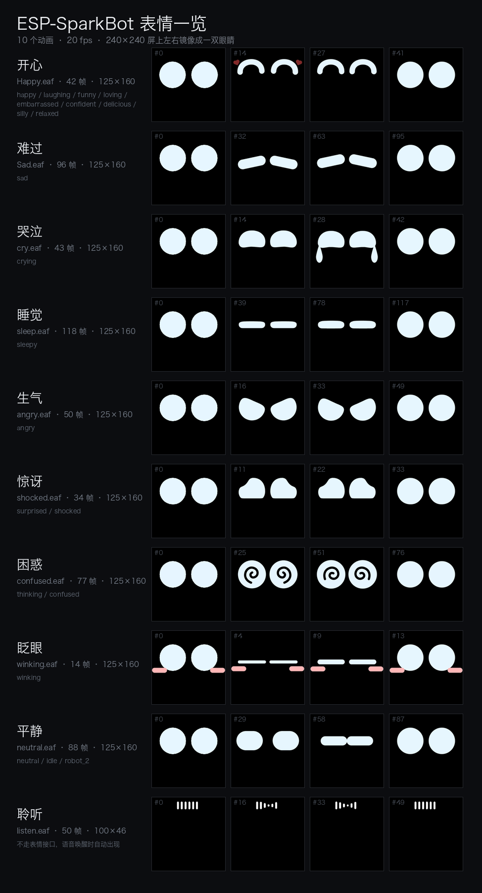
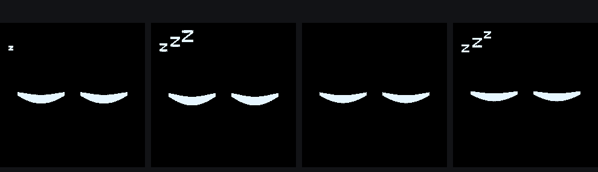

# ESP-SparkBot

给乐鑫 **ESP-SparkBot** 加上**局域网直连**与**远程遥控**：小智 AI 的语音对话照常工作，
但不再只能靠说话控制——手机可以像遥控车一样实时开它、看摄像头画面，出了家门也能用。

> 官方固件连上 Wi-Fi 后只做一件事：向小智云维持一条 WebSocket。设备侧**不监听任何本地端口**，
> 所以「同一个局域网里用 IP 访问」这条路官方从来没提供过。本项目把这条路补上。

本仓装着**控制端**和**文档**：Android App、固件改造说明、底盘补丁。
改了固件的那份源码在独立仓 **[xiaozhi-esp32-sparkbot](https://github.com/Jister24/xiaozhi-esp32-sparkbot)**，
clone 下来直接能编译；本仓的 `firmware/apply.py` 则是往现成上游 checkout 上打补丁的可选路径。

## 现在能做什么

| 能力 | 说明 |
|---|---|
| 设备发现 | 扫描 `/24` 网段（两轮探测，兼容刚开机时 700~950ms 的高延迟），也可手动输入 IP、多设备保存切换 |
| 实时遥控 | 方向圆盘：按住拖动、吸附八向，松手即停（200ms 重发压住底盘 500ms 看门狗），速度 10%~100%，另有急停 |
| 摄像头画面 | MJPEG 实时预览，自解析 SOI/EOI 切帧；可拍照存相册、切换画面方向 |
| 边看边开 | 相机页同一个圆盘直接开，视线不用离开画面 |
| 表情与底盘 | 跳舞、灯光 0~8 档、原厂 emote 动画表情，全部可本地触发 |
| 电量显示 | 设备页两块电池并排：本体（GPIO14 分压）与底盘（C2 经 UART 上报），各带百分比、电压与充电标识 |
| 账号管理 | 内嵌官方控制台，角色 / 音色 / 声纹 / OTA / 历史对话都走官方页面 |
| 远程访问 | 不在同一网络、没有公网 IP 也能连——家里 NAS 做隧道，固件零改动 |

## 界面

| 设备 | 遥控 | 相机 | 账号 |
|---|---|---|---|
|  |  |  |  |

「设备」页顶部可以在**局域网 / 远程**之间切换，下面四个页面完全共用——换连接方式不影响操作习惯。

## 表情

屏幕走的是 emote 动画方案（不是 LVGL）：一份 `.eaf` 里其实是**一只眼**，`layout.json` 的
`eye_anim` 用 `mirror: auto` 左右各贴一次，才拼成一双。所以表情只有眼睛，没有嘴。



10 个动画文件对应 21 个表情名，服务端下发哪个名字都能接住：

| 文件 | 帧数 | 覆盖的表情名 |
|---|---|---|
| `Happy.eaf` | 42 | happy / laughing / funny / loving / embarrassed / confident / delicious / silly / relaxed |
| `Sad.eaf` | 96 | sad |
| `cry.eaf` | 43 | crying |
| `sleep.eaf` | 40 | sleepy（本仓库重画：全程闭眼，见下） |
| `angry.eaf` | 50 | angry |
| `shocked.eaf` | 34 | surprised / shocked |
| `confused.eaf` | 77 | thinking / confused |
| `winking.eaf` | 14 | winking |
| `neutral.eaf` | 88 | neutral / idle / robot_2 |
| `listen.eaf` | 50 | 不是表情：唤醒后的聆听波形条，走 `SetStatus(LISTENING)` |

上面这张图和动图 [`docs/images/emotions.gif`](docs/images/emotions.gif)（十宫格同时播放）
都由 `firmware/tools/eaf_render.py` 从 `.eaf` 里解出来，用来核对素材、改配色或写文档：

```bash
python3 firmware/tools/eaf_render.py          # 总览图 + 十宫格动图
python3 firmware/tools/eaf_render.py --list   # 只看清单与帧数
```

`.eaf` 素材属于 `espressif/esp_emote_assets` 组件，不在本仓库；脚本默认去
`~/esp/xiaozhi-esp32/managed_components/` 下找，可用 `--assets` 指定。

### 睡觉这套是自己画的

原厂的 `sleep.eaf` 是个变形动画：从一个大白圆（等于还睁着眼）压扁成横杠，
切到睡觉时会有一瞬间像没闭上。这一份重画成 40 帧纯闭眼（20fps，2 秒一次呼吸），
另外配一个 24 帧的 `zzz.eaf` 飘在左上角：



zzz 没有画进 `sleep.eaf`，因为 `eye_anim` 是 `mirror: auto`——写进去的 z 会被镜像成
两份、右边那份还是反的。渲染上它在 `EmoteDisplay::UpdateZzzOverlay` 里另建一个
gfx anim 对象（`SetEmotion("sleepy")` 时 start + 显示，其它表情或聆听/说话时
stop + 隐藏），落点 (8, 6)，正好躲开右上角的电量角标。

两份素材的生成脚本（Pillow，直接产出 `.eaf`）：

```bash
python3 firmware/tools/emote_sleep.py            # 出 sleep.eaf / zzz.eaf + 上面这张预览
python3 firmware/tools/emote_sleep.py --install  # 顺带拷进 xiaozhi 的 emote 素材目录
```

`.eaf` 的写入口径在 `firmware/tools/eaf_write.py`：8bit 调色板 + 块内 RLE（编码
类型 0），文件头校验和是 `[16, 16+表长)` 的字节和，算错会直接 `ESP_ERR_INVALID_CRC`。

## 两条链路，一套接口

```
                    ┌─ 局域网：手机 ──HTTP──> 设备:8080 控制 / :8081 图传
ESP32-S3 机器人 ────┤
                    └─ 远程：  手机 ──HTTPS──> 云服务器 Nginx(鉴权/TLS)
                                                  └─ frps ──隧道──> 家里 NAS frpc ──> 设备
```

固件里 `LocalControl` 模块开放两个端口，与原有小智云链路并存、互不影响：

| 端口 | 路径 | 说明 |
|---|---|---|
| 8080 | `/status` `/move?x=&y=` `/stop` `/cmd?c=` `/rot` | 控制，局域网往返 20~40ms（详见下方 `ps` 字段） |
| 8081 | `/stream` `/snapshot` | MJPEG 连续流 / 单帧 JPEG |

`/status` 返回 `ip / x / y / uptime_s / camera / rot / ps / batt / batt_mv / charging`，
底盘上报时还会多出 `chassis_batt / chassis_batt_mv / chassis_charging`。
电量字段在不可用时整段省略，不会给假值：老固件没有主体板电池检测就少 `batt` 三兄弟，
底盘没刷过上报固件就少 `chassis_*` 三兄弟。

`ps` 是当前的 Wi-Fi 省电档位。固件默认让 IDF 走 `MIN_MODEM`，一旦有客户端发请求就
切到 `WIFI_PS_NONE`，静默 30 秒后自动回退——遥控是实时操作，省电带来的 100ms 唤醒周期
会让指令延迟到几百毫秒甚至两秒，得不偿失；没人用的时候则没必要一直醒着。

**为什么拆两个端口**：ESP-IDF 的 `httpd` 是单任务串行处理，抓一帧 + JPEG 编码约 300~500ms。
如果和控制指令共用实例，推流期间动圆盘会有半秒延迟。拆开后控制端永不被图像阻塞。

App 侧用一个 `Endpoint` 密封接口把「网络位置」收成类型属性，业务层与页面完全不知道自己在走 Wi-Fi 还是隧道。

## 硬件

| 部件 | 型号 / 参数 |
|---|---|
| 主控 | ESP32-S3（8MB Octal PSRAM / 16MB Flash，原生 USB-Serial/JTAG） |
| 底盘 | ESP32-C2，UART 指令控制（`d1` 跳舞、`w2` 灯光、`x0.5 y0.5` 移动） |
| 摄像头 | GC2145（DVP 8-bit，输出 240×240；**不是**上游默认的 OV2640） |
| 屏幕 | 240×240 LCD，emote 动画表情 |
| 音频 | ES8311 编解码，16kHz |

> 上游 `esp-sparkbot` 板级配置只启用了 OV2640，不补 GC2145 会导致图传与拍照全部失效。
> `firmware/apply.py` 已包含这项修正。

## 快速开始

### 1. 拿到固件

固件本体在独立仓 **[xiaozhi-esp32-sparkbot](https://github.com/Jister24/xiaozhi-esp32-sparkbot)**，
直接 clone 就能编译，**不需要打补丁**：

```bash
git clone https://github.com/Jister24/xiaozhi-esp32-sparkbot.git
cd xiaozhi-esp32-sparkbot
. $IDF_PATH/export.sh                      # 需要 ESP-IDF v6.0.1+
python scripts/build.py espressif/esp-sparkbot
idf.py -p /dev/cu.usbmodem* flash monitor
```

> **别用裸 `idf.py build`。** 板型由 `CONFIG_BOARD_TYPE_ESP_SPARKBOT` 决定，这个宏是
> `scripts/build.py` 从板级 `config.json` 合并进 sdkconfig 的，`-DBOARD_NAME=` 对 CMake
> 不起作用。直接 idf.py 一样报 build complete、一样出 `xiaozhi.bin`，但板级源码一个都
> 没编进去，烧了还是老固件——这个坑踩过不止一次。

#### 可选：把改动叠在自己那份上游上

`firmware/apply.py` 是另一条路，往现成的 xiaozhi-esp32 checkout 上外挂同样的改动，
适合已经跟着上游主线走、不想维护分叉的情况。它只做插入、不删改原有逻辑，幂等且可精确回滚；
代价是依赖源码锚点，上游改动锚点附近代码时会失败。

```bash
git clone https://github.com/78/xiaozhi-esp32.git
cd xiaozhi-esp32
python3 /path/to/ESP_SPARKBOT/firmware/apply.py .          # 打补丁
python3 /path/to/ESP_SPARKBOT/firmware/apply.py . --check  # 只看会改什么
python3 /path/to/ESP_SPARKBOT/firmware/apply.py . --revert # 回滚
python scripts/build.py espressif/esp-sparkbot
```

两条路重叠的部分：遥控与图传、GC2145 支持、图像 180° 纠正、主体板电池采样（GPIO14 分压）、
底盘电量读取（经板间 UART 问 C2，需要底盘刷过 [`firmware/chassis/`](firmware/chassis/) 的补丁）、
`self.battery.get_status` 语音工具、低功耗时的省电与切表情。`/status` 因此多出 `batt` /
`batt_mv` / `charging` 与 `chassis_*` 三兄弟，App 的电源卡才有数可显示。

**补丁版不碰显示方案**。固件仓在 240×240 上用的是 emote（表情）渲染，带自己的一套素材、
布局和 gfx 叠加层；补丁版沿用上游默认的 LVGL 界面，所以这些都不在里面：

- 屏幕右上角的电量角标（含百分比）。电量在 App 与 `/status` 里照样拿得到。
- 重画的闭眼睡脸和 zzz 叠加层。素材生成脚本在 [`firmware/tools/`](firmware/tools/)，
  但要用上得先切到 emote 显示方案——也就是固件仓的那套做法。

### 2. 选一个控制端

**Android App**（`android/`，Kotlin + Jetpack Compose，包名 `com.shike.sparkbot`，
minSdk 26 / targetSdk 35）。

不想编译就直接装 → **[下载 APK](https://github.com/Jister24/ESP_SPARKBOT/releases/latest)**
（9.2 MB，debug 签名，安装时需允许「未知来源」）。

> `main` 分支不含任何构建产物，APK 只作为 Release 附件发布。
> 下载后建议核对一下（`shasum -a 256 文件名`，Windows 用 `certutil -hashfile 文件名 SHA256`）：
>
> ```
> 2699fb783c521bf59765c27b1f5aceff873e26fa49eb70b9ca21913783e0d91c
> ```

自己编译：

```bash
cd android && ./gradlew assembleDebug
adb install -r app/build/outputs/apk/debug/app-debug.apk
```

**或者 Python 脚本**（`client/sparkbot.py`，零依赖，适合先验证链路）：

```bash
python3 client/sparkbot.py status              # 看状态
python3 client/sparkbot.py drive               # 键盘遥控（WASD）
python3 client/sparkbot.py move forward --speed 0.6
python3 client/sparkbot.py snap shot.jpg       # 抓一帧
python3 client/sparkbot.py watch               # 终端里看图传
```

### 3. 远程访问（可选）

不在家也想控制时，用家里 NAS 跑 frpc 把设备端口隧道到云服务器，Nginx 套上 TLS 与鉴权。
**固件和 App 都不需要为远程改一行代码**，App 里切到「远程」填地址账号即可。

完整方案（选型对比、配置、踩坑合集）见 **[docs/remote-access.md](docs/remote-access.md)**，
配置模板在 [`remote/`](remote/)。

## 目录结构

```
.
├── firmware/              固件改造（完整源码见 xiaozhi-esp32-sparkbot 仓）
│   ├── apply.py           可选：把遥控、图传与电量注入现成的 xiaozhi-esp32（幂等、可回滚）
│   ├── local_control.h/.cc   8080 控制 + 8081 图传，复用现有 UART 与摄像头
│   ├── chassis_battery.h/.cc 经板间 UART 向底盘 C2 问电量
│   ├── chassis/           底盘（ESP32-C2）补丁与飞线说明
│   ├── emote_style/       240×240 表情素材与布局
│   └── tools/             .eaf 解码渲染 / 编码器 / 睡脸与 zzz 素材生成
├── android/               原生 App（Compose，四个页面 + Endpoint 抽象）
├── client/sparkbot.py     零依赖命令行客户端
├── remote/                远程访问配置模板（frps / frpc / Nginx / 极空间部署）
└── docs/
    ├── images/            表情总览图与动图（由 tools/eaf_render.py 生成）
    ├── remote-access.md   远程方案：为什么这么选、怎么落地、踩过哪些坑
    └── dev-log.md         开发日志：每个改动的原因、验证数据与失败尝试
```

## 文档

| 文档 | 内容 |
|---|---|
| [docs/remote-access.md](docs/remote-access.md) | 远程访问方案：六种选型的淘汰理由、架构、按层分组的踩坑表、`Endpoint` 设计 |
| [docs/dev-log.md](docs/dev-log.md) | 开发日志：为什么原本连不上、帧率上限的实测依据、画面倒立的根因、每一项验证数据 |
| [remote/nas-deploy.md](remote/nas-deploy.md) | 极空间 Z2Pro 部署 frpc 的逐项操作与容器内排障 |
| [firmware/wakeword-request-doubaodoubao.md](firmware/wakeword-request-doubaodoubao.md) | 唤醒词定制说明 |

## 已知限制

- **图传约 1.6 fps**。瓶颈在固件（GC2145 抓帧 + 软件 JPEG 编码 500~600ms/帧），不在网络——
  单帧 28KB、约 360kbps，家宽上行占用 1%。想提速要降分辨率或走硬件 JPEG。
- **8081 同一时刻只服务一个客户端**。httpd 单任务，App 预览时电脑再连会阻塞，所以拍照是
  「停流 → 抓单帧 → 恢复流」。
- **设备本身没有鉴权**。局域网直连假定你信任自己的网络；远程模式由 Nginx Basic Auth 兜底，
  密码泄露等于车钥匙泄露。
- **账号页是内嵌 WebView**。官方没有公开 API，全原生重写等于逆向一套随时会变的私有接口。
- **电量是开路电压估算**。百分比按 11 点 OCV 曲线插值，带载时读数会被拉低，快充满时
  会偏乐观；充电状态没有硬件指示脚，是「电压趋势」推断出来的。底盘那块电池由 C2 自己的
  ADC 采样后经 UART 上报，但底盘 PCB 上的 USB 口只供电、不走数据，要刷这部分固件得从
  C2 的 UART0/EN/GPIO9 测试点飞线。
- 远程模式的凭据以明文存在 SharedPreferences，自用足够，多用户场景需要换成短期 token。

## 致谢

- [78/xiaozhi-esp32](https://github.com/78/xiaozhi-esp32) —— 小智 AI 固件本体。
  改造后的完整源码在 [xiaozhi-esp32-sparkbot](https://github.com/Jister24/xiaozhi-esp32-sparkbot)（基线 `c435f99`）
- 乐鑫 ESP-SparkBot 板级与 emote 动画方案
- [fatedier/frp](https://github.com/fatedier/frp) —— 远程访问的穿透层

## License

[MIT](LICENSE)
