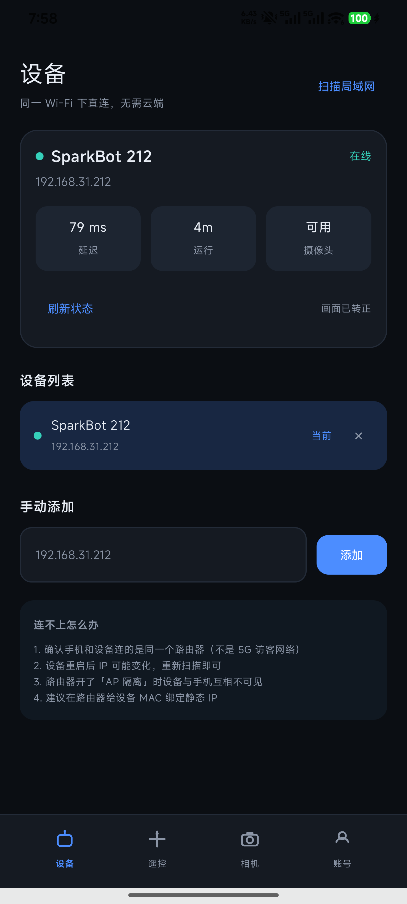
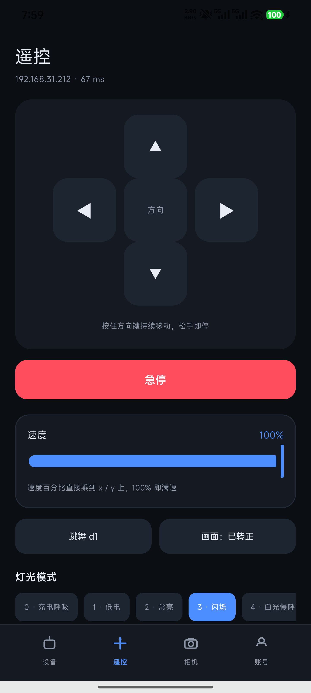
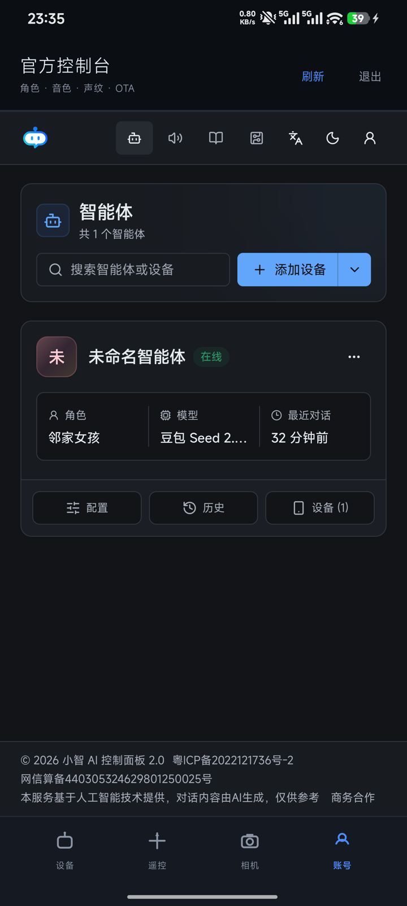

# ESP-SparkBot

给乐鑫 **ESP-SparkBot** 加上**局域网直连**与**远程遥控**：小智 AI 的语音对话照常工作，
但不再只能靠说话控制——手机可以像遥控车一样实时开它、看摄像头画面，出了家门也能用。

> 官方固件连上 Wi-Fi 后只做一件事：向小智云维持一条 WebSocket。设备侧**不监听任何本地端口**，
> 所以「同一个局域网里用 IP 访问」这条路官方从来没提供过。本项目把这条路补上。

## 现在能做什么

| 能力 | 说明 |
|---|---|
| 设备发现 | 扫描 `/24` 网段（两轮探测，兼容刚开机时 700~950ms 的高延迟），也可手动输入 IP、多设备保存切换 |
| 实时遥控 | 方向键按住持续行走（200ms 重发压住底盘 500ms 看门狗），速度 10%~100%，随时急停 |
| 摄像头画面 | MJPEG 实时预览，自解析 SOI/EOI 切帧；可拍照存相册、切换画面方向 |
| 边看边开 | 相机页直接用方向键，视线不用离开画面 |
| 表情与底盘 | 跳舞、灯光 0~8 档、原厂 emote 动画表情，全部可本地触发 |
| 电量显示 | 设备页两块电池并排：本体（GPIO14 分压）与底盘（C2 经 UART 上报），各带百分比、电压与充电标识 |
| 账号管理 | 内嵌官方控制台，角色 / 音色 / 声纹 / OTA / 历史对话都走官方页面 |
| 远程访问 | 不在同一网络、没有公网 IP 也能连——家里 NAS 做隧道，固件零改动 |

## 界面

| 设备 | 遥控 | 相机 | 账号 |
|---|---|---|---|
|  |  |  |  |

「设备」页顶部可以在**局域网 / 远程**之间切换，下面四个页面完全共用——换连接方式不影响操作习惯。

## 两条链路，一套接口

```
                    ┌─ 局域网：手机 ──HTTP──> 设备:8080 控制 / :8081 图传
ESP32-S3 机器人 ────┤
                    └─ 远程：  手机 ──HTTPS──> 云服务器 Nginx(鉴权/TLS)
                                                  └─ frps ──隧道──> 家里 NAS frpc ──> 设备
```

固件里 `LocalControl` 模块开放两个端口，与原有小智云链路并存、互不影响：

| 端口 | 路径 | 说明 |
|---|---|---|
| 8080 | `/status` `/move?x=&y=` `/stop` `/cmd?c=` `/rot` | 控制，响应 <10ms |
| 8081 | `/stream` `/snapshot` | MJPEG 连续流 / 单帧 JPEG |

`/status` 返回 `ip / x / y / uptime_s / camera / rot / batt / batt_mv / charging`，
底盘上报时还会多出 `chassis_batt / chassis_batt_mv / chassis_charging`。
电量字段在不可用时整段省略，不会给假值：老固件没有主体板电池检测就少 `batt` 三兄弟，
底盘没刷过上报固件就少 `chassis_*` 三兄弟。

**为什么拆两个端口**：ESP-IDF 的 `httpd` 是单任务串行处理，抓一帧 + JPEG 编码约 300~500ms。
如果和控制指令共用实例，推流期间按方向键会有半秒延迟。拆开后控制端永不被图像阻塞。

App 侧用一个 `Endpoint` 密封接口把「网络位置」收成类型属性，业务层与页面完全不知道自己在走 Wi-Fi 还是隧道。

## 硬件

| 部件 | 型号 / 参数 |
|---|---|
| 主控 | ESP32-S3（8MB Octal PSRAM / 16MB Flash，原生 USB-Serial/JTAG） |
| 底盘 | ESP32-C2，UART 指令控制（`d1` 跳舞、`w2` 灯光、`x0.5 y0.5` 移动） |
| 摄像头 | GC2145（DVP 8-bit，输出 240×240；**不是**上游默认的 OV2640） |
| 屏幕 | 240×240 LCD，emote 动画表情 |
| 音频 | ES8311 编解码，16kHz |

> 上游 `esp-sparkbot` 板级配置只启用了 OV2640，不补 GC2145 会导致图传与拍照全部失效。
> `firmware/apply.py` 已包含这项修正。

## 快速开始

### 1. 给固件打补丁

需要 ESP-IDF v5.4+ 和一份 [xiaozhi-esp32](https://github.com/78/xiaozhi-esp32) 源码：

```bash
git clone https://github.com/78/xiaozhi-esp32.git
cd xiaozhi-esp32
python3 /path/to/ESP_SPARKBOT/firmware/apply.py .          # 打补丁
python3 /path/to/ESP_SPARKBOT/firmware/apply.py . --check  # 只看会改什么
python3 /path/to/ESP_SPARKBOT/firmware/apply.py . --revert # 回滚
```

补丁只做插入、不删改原有逻辑，幂等且可精确回滚。之后正常编译烧录：

```bash
idf.py set-target esp32s3
idf.py menuconfig      # Xiaozhi Assistant → Board Type → esp-sparkbot
idf.py build flash monitor
```

### 2. 选一个控制端

**Android App**（`android/`，Kotlin + Jetpack Compose，包名 `com.shike.sparkbot`，
minSdk 26 / targetSdk 35）。

不想编译就直接装 → **[下载 APK](https://github.com/Jister24/ESP_SPARKBOT/releases/latest)**
（9.2 MB，debug 签名，安装时需允许「未知来源」）。

> `main` 分支不含任何构建产物，APK 只作为 Release 附件发布。
> 下载后建议核对一下（`shasum -a 256 文件名`，Windows 用 `certutil -hashfile 文件名 SHA256`）：
>
> ```
> 03cfc023b793e07eb41a84d53098caed8a3ca6bb30396f439b69a89fd55949a7
> ```

自己编译：

```bash
cd android && ./gradlew assembleDebug
adb install -r app/build/outputs/apk/debug/app-debug.apk
```

**或者 Python 脚本**（`client/sparkbot.py`，零依赖，适合先验证链路）：

```bash
python3 client/sparkbot.py status              # 看状态
python3 client/sparkbot.py drive               # 键盘遥控（WASD）
python3 client/sparkbot.py move forward --speed 0.6
python3 client/sparkbot.py snap shot.jpg       # 抓一帧
python3 client/sparkbot.py watch               # 终端里看图传
```

### 3. 远程访问（可选）

不在家也想控制时，用家里 NAS 跑 frpc 把设备端口隧道到云服务器，Nginx 套上 TLS 与鉴权。
**固件和 App 都不需要为远程改一行代码**，App 里切到「远程」填地址账号即可。

完整方案（选型对比、配置、踩坑合集）见 **[docs/remote-access.md](docs/remote-access.md)**，
配置模板在 [`remote/`](remote/)。

## 目录结构

```
.
├── firmware/              固件补丁
│   ├── apply.py           把 LocalControl 注入 xiaozhi-esp32（幂等、可回滚）
│   ├── local_control.h/.cc  8080 控制 + 8081 图传，复用现有 UART 与摄像头
│   └── emote_style/       240×240 表情素材与布局
├── android/               原生 App（Compose，四个页面 + Endpoint 抽象）
├── client/sparkbot.py     零依赖命令行客户端
├── remote/                远程访问配置模板（frps / frpc / Nginx / 极空间部署）
├── docs/
│   ├── remote-access.md   远程方案：为什么这么选、怎么落地、踩过哪些坑
│   └── dev-log.md         开发日志：每个改动的原因、验证数据与失败尝试
└── backup/                设备原始固件的快照（大文件不入库）
```

## 文档

| 文档 | 内容 |
|---|---|
| [docs/remote-access.md](docs/remote-access.md) | 远程访问方案：六种选型的淘汰理由、架构、按层分组的踩坑表、`Endpoint` 设计 |
| [docs/dev-log.md](docs/dev-log.md) | 开发日志：为什么原本连不上、帧率上限的实测依据、画面倒立的根因、每一项验证数据 |
| [remote/nas-deploy.md](remote/nas-deploy.md) | 极空间 Z2Pro 部署 frpc 的逐项操作与容器内排障 |
| [firmware/wakeword-request-doubaodoubao.md](firmware/wakeword-request-doubaodoubao.md) | 唤醒词定制说明 |

## 已知限制

- **图传约 1.6 fps**。瓶颈在固件（GC2145 抓帧 + 软件 JPEG 编码 500~600ms/帧），不在网络——
  单帧 28KB、约 360kbps，家宽上行占用 1%。想提速要降分辨率或走硬件 JPEG。
- **8081 同一时刻只服务一个客户端**。httpd 单任务，App 预览时电脑再连会阻塞，所以拍照是
  「停流 → 抓单帧 → 恢复流」。
- **设备本身没有鉴权**。局域网直连假定你信任自己的网络；远程模式由 Nginx Basic Auth 兜底，
  密码泄露等于车钥匙泄露。
- **账号页是内嵌 WebView**。官方没有公开 API，全原生重写等于逆向一套随时会变的私有接口。
- **电量是开路电压估算**。百分比按 11 点 OCV 曲线插值，带载时读数会被拉低，快充满时
  会偏乐观；充电状态没有硬件指示脚，是「电压趋势」推断出来的。底盘那块电池由 C2 自己的
  ADC 采样后经 UART 上报，但底盘 PCB 上的 USB 口只供电、不走数据，要刷这部分固件得从
  C2 的 UART0/EN/GPIO9 测试点飞线。
- 远程模式的凭据以明文存在 SharedPreferences，自用足够，多用户场景需要换成短期 token。

## 致谢

- [78/xiaozhi-esp32](https://github.com/78/xiaozhi-esp32) —— 小智 AI 固件本体，本项目以补丁形式叠加
- 乐鑫 ESP-SparkBot 板级与 emote 动画方案
- [fatedier/frp](https://github.com/fatedier/frp) —— 远程访问的穿透层

## License

[MIT](LICENSE)
